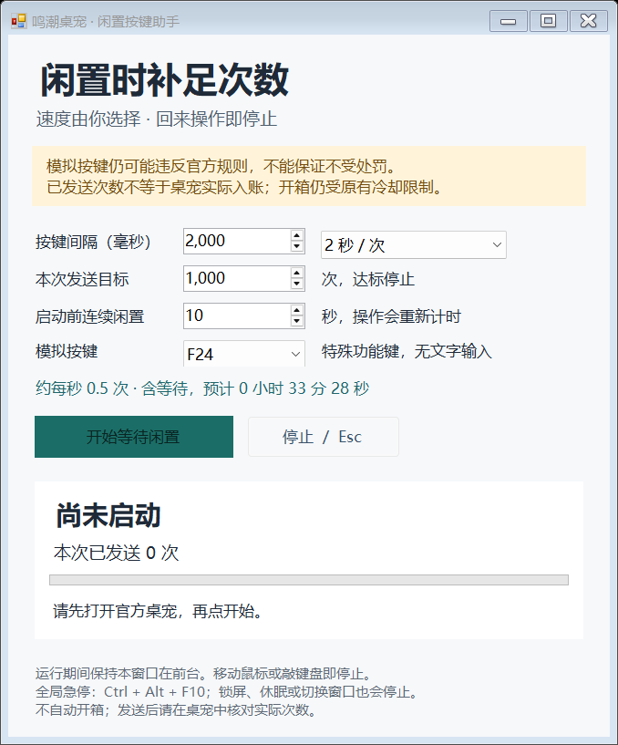

# WuwaTappo Idle Helper

鸣潮桌宠 · 闲置按键助手。面向 Windows 10/11，依赖系统 .NET Framework 4.x，无需管理员权限；其他系统和配置未逐一验证。

从 [Releases 下载](https://github.com/yi-yezhiqiu/WuwaTappo-IdleHelper/releases/latest)便携版 ZIP，解压后双击 **TappoIdleHelper.exe**。源码仓库不保存编译生成的 EXE，也可以按文末说明自行构建。

## 使用

1. 先打开官方 Wuwa Tappo，并完成你自己的登录。
2. 打开助手，选择间隔、发送目标、连续闲置等待时间和模拟按键。
3. 点击“开始等待闲置”，保持助手窗口在前台，然后离开键盘和鼠标。
4. 等待结束后开始发送；达到目标自动停止。回来移动鼠标或按任意键也会停止，继续使用需手动重新启动。
5. 回到桌宠检查实际余额，再按原规则开箱。

建议第一次把目标设为 **5 次**，等待发完后检查桌宠是否增加计数。程序仅统计 Windows 成功接收的合成按键对，**不读取桌宠余额，不能证明服务器入账**。如果没有增加，停止使用；可以自行试选另一个功能键，工具不会绕过桌宠的输入过滤或限制。

## 速度可自行选择

间隔支持 **50–10000 毫秒**，可以直接输入，也可以选择常用速度；运行时锁定配置，停止后可修改。默认每 2 秒一次，目标 1000 次，连续闲置 10 秒后启动。

| 间隔 | 约每秒发送 | 1000 次约需用时（不含闲置等待） |
| --- | --- | --- |
| 2000 毫秒 | 0.5 次 | 33 分 18 秒 |
| 1000 毫秒 | 1 次 | 16 分 39 秒 |
| 500 毫秒 | 2 次 | 8 分 20 秒 |
| 200 毫秒 | 5 次 | 3 分 20 秒 |
| 100 毫秒 | 10 次 | 1 分 40 秒 |
| 50 毫秒 | 20 次 | 50 秒 |

第一对按键在闲置等待结束时发送，所以时间约为 `(次数 - 1) × 间隔`。Windows 定时器会有误差，程序不会在卡顿后集中补发。

官方说明：累计 30 分钟有效活跃时间生成一个宝箱，开箱消耗 1000 输入次数，最多保留两个未开启宝箱，满槽后暂停计时。**加快输入不会跳过宝箱冷却，也不能保证合成输入被计为有效活跃时间。**

## 停止方式和保护

- 移动鼠标、点击鼠标或按任意实体键；助手不会阻止这些真实输入。
- Esc、停止按钮、全局快捷键 **Ctrl + Alt + F10**，或关闭窗口。
- 切换到其他窗口、最小化、锁屏、会话断开、休眠、桌宠退出、发送失败均停止，需要手动重启任务。
- 不能建立键鼠监听或注册急停快捷键时，禁止启动。若快捷键被其他程序占用，界面会提示。
- 界面循环停顿超过 200 毫秒时停止，防止长卡顿后继续发送；每次手动启动都会重新建立键鼠监听。系统繁忙也可能触发这项保护。

使用 F21–F24 特殊功能键，不输入文字；某些软件可能绑定这些键，因此运行时需要保持助手自身在前台。焦点检查与系统输入发送不是原子操作，不能对所有系统竞争情况保证完全隔离。锁屏或休眠时不运行。鼠标轻微抖动也可能触发停止。

助手不自动开箱、不自动启动桌宠、不自启、不安装服务、不修改系统设置。不读取账号凭据、原程序或计数文件，不调用游戏内部接口；仅在内存中保留本次发送数，不记录按键内容或鼠标位置，不进行网络通信。退出助手即停止。

## 规则风险

这是自行编写的第三方工具，未经库洛授权，与库洛及 Wuwa Tappo 官方无隶属关系。使用前请阅读官方规则，自行评估风险。

截至 2026-10-28 查阅的官方《库洛用户协议》4.4.6 包含对未经授权第三方软件等工具的限制，并有对异常数据/行为的处理条款；官方应用字典包含“客户端点击数异常”（70003）和“宝箱冷却中”（70006）。**普通模拟按键、较低频率、闲置运行均不能保证不违规或不被处罚，也不代表软件不可检测。**这里只实现常规系统合成输入，没有隐藏输入来源、规避检测或修改冷却的功能。

- [官方协议入口](https://sdk.kurogames.com/pro/agreement/common/language_zh-Hans/terms_of_service)
- [官方协议 PDF](https://pro-cdn-sdk.kurogame.com/pro/agreement/common/language_zh-Hans/terms_of_service.pdf)
- [官方公开应用文案](https://mc-wuwatappo.kurogames-global.com/app/dict/zh.json)
- [官方下载页](https://download-mc-wuwatappo.kurogames-global.com/download/)

2026-10-28 查阅。[AutoTappo 的合成按键实现](https://github.com/To0Ru/AutoTappo/blob/main/src-tauri/src/clicker.rs)仅用于技术路线研究，本工具未复制其源码，也未运行任何第三方发布程序。第三方作者所称“不会封号”不能视为官方保证。

## 源码和验证

- `src/IdleEngine.cs`：闲置等待、频率、目标与停止状态机。
- `src/NativeInput.cs`：系统合成输入和实体输入监听。
- `src/LoopGuard.cs`：界面长停顿保护。
- `src/Program.cs`：中文 WinForms 窗口、配置与会话保护。
- `tests/EngineTests.cs`：假时钟测试，不向真实桌面发送输入。

在本目录用 PowerShell 运行 `./build.ps1`，会先编译、执行调度测试，再生成正式 exe；使用 Windows 自带 .NET Framework 编译器，不需下载依赖。

如果现有 EXE 正在运行，可以先关闭它，或使用 `./build.ps1 -OutputPath TappoIdleHelper-new.exe` 构建到其他文件名。

`./build.ps1 -CheckWindowsProtection` 还会短暂安装、清理并重装键鼠监听和急停快捷键，不显示窗口、不发送输入、不修改系统设置。受限会话可能拒绝全局快捷键（Windows 错误 5），这种情况下工具会禁止启动。

`TappoIdleHelper.exe --smoke-test <预览图片路径>` 只构造、渲染界面并检查本机 INPUT 结构布局，不安装钩子、不注册快捷键、不发送按键。构建和自动测试通过不等于已经在真实账号上验证计数、活跃时间或开箱；这些需要现场核对。

本次验证（2026-10-28）：27/27 逻辑测试通过、正式 exe 编译通过、无输入界面检查通过、正常 Windows 会话下监听/急停快捷键安装与重装检查通过。没有在真实桌宠中刷次数或领取奖励。

## 许可证

工具源码按 [MIT License](LICENSE) 发布。Wuwa Tappo 及鸣潮相关名称、角色和原软件归各自权利人所有；本仓库不分发原软件或角色素材。
